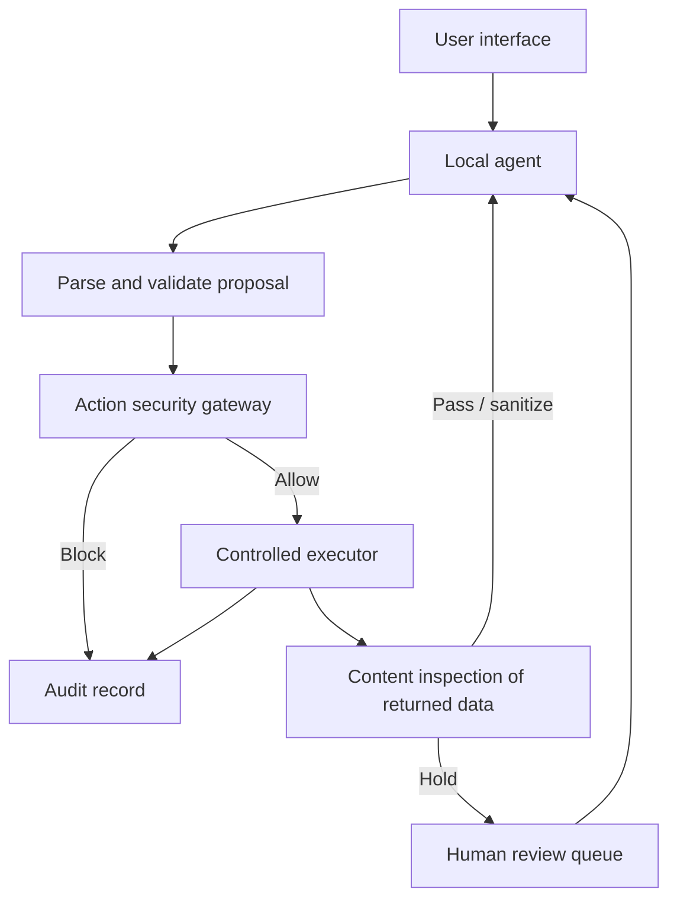

# AI Agent Security Middleware

College mini-project: **Development of AI Agent Security Middleware for Prompt Injection Detection and Unsafe Action Prevention**.

## Purpose

This project will build a local security layer between an AI agent and a small set of approved tools. The model may propose an operation, but the application must validate and authorize it before execution. Retrieved text is treated as untrusted input and can be passed, sanitized, or held for review.

The repository is at the planning stage. No application code, tests, or runtime dependencies are present yet. See [the project tracker](docs/PROJECT_TRACKER.md) for verified status and acceptance criteria.

## Intended architecture



The model will not receive direct access to the filesystem, database, or message delivery. Initial tools are intended to search/read approved documents, query records through fixed functions, and save drafts to a simulated local outbox. This is an application-level gateway, not an operating-system sandbox.

## Intended technology stack

Python, Ollama with `qwen3.5:4b`, Pydantic, FastAPI, SQLite, Streamlit, and Pytest. The Python environment and local model are verified; application features are still planned.

## Repository contents

```text
ai-security-middleware/
├── README.md
├── security_middleware/
│   ├── agent_loop.py
│   ├── action_gateway.py
│   ├── content_protection.py
│   ├── controlled_tools.py
│   ├── demo_tools.py
│   ├── models.py
│   └── ollama_client.py
│   ├── review_queue.py
│   └── secure_retrieval.py
├── docs/
│   ├── ARCHITECTURE.md
│   ├── CONTRIBUTION_GUIDELINES.md
│   ├── DEVELOPMENT.md
│   ├── GIT_AND_GITHUB_GUIDE.md
│   ├── IMPLEMENTATION_ROADMAP.md
│   ├── LEARNING_GUIDE.md
│   ├── PROJECT_TRACKER.md
│   ├── SECURITY_MODEL.md
│   ├── SETUP_AND_INSTALLATION.md
│   ├── TEAM_WORKFLOW.md
│   └── TESTING.md
├── scripts/
│   ├── run_agent_demo.py
│   ├── run_controlled_tools_demo.py
│   ├── run_gateway_demo.py
│   ├── run_secure_retrieval_demo.py
│   └── verify_ollama.py
├── sample_data/
│   └── documents/
└── tests/
    ├── test_action_gateway.py
    ├── test_agent_loop.py
    ├── test_content_protection.py
    └── test_controlled_tools.py
    └── test_secure_retrieval.py
```

## Prerequisites and setup

There is no runnable application or dependency file yet, so environment setup and run commands are not available at this stage. Do not install packages or download a model until the environment milestone is approved. The planned setup will be documented with exact PowerShell commands after Python and package versions are selected and checked.

## Current status

- Implemented: repository audit, initial documentation, local environment verification, bounded demonstration agent loop, controlled local tools, action security gateway, and secure document retrieval.
- Verified: Python 3.14; Ollama 0.40.15; `qwen3.5:4b` (4.2B Q4, 3.3 GB); a Python request and structured tool proposal.
- Not implemented: persistent audit storage, API, dashboard, and model access to controlled tools.

## Run the current demonstration

From the repository root:

```powershell
.\.venv\Scripts\python.exe -m scripts.run_agent_demo
```

The demonstration has one fixed tool, `get_project_status`. It returns text stored in the program and cannot access external resources. Run the current tests with:

```powershell
.\.venv\Scripts\python.exe -m pytest -q
```

Run the controlled local-tool demonstration with:

```powershell
.\.venv\Scripts\python.exe -m scripts.run_controlled_tools_demo
```

Run the gateway demonstration with:

```powershell
.\.venv\Scripts\python.exe -m scripts.run_gateway_demo
```

Run the secure document retrieval demonstration with:

```powershell
.\.venv\Scripts\python.exe -m scripts.run_secure_retrieval_demo
```

## Documentation

- [Architecture](docs/ARCHITECTURE.md)
- [Learning guide](docs/LEARNING_GUIDE.md)
- [Implementation roadmap](docs/IMPLEMENTATION_ROADMAP.md)
- [Setup and installation](docs/SETUP_AND_INSTALLATION.md)
- [Git and GitHub guide](docs/GIT_AND_GITHUB_GUIDE.md)
- [Contribution guidelines](docs/CONTRIBUTION_GUIDELINES.md)
- [Security model](docs/SECURITY_MODEL.md)
- [Testing plan](docs/TESTING.md)
- [Team workflow](docs/TEAM_WORKFLOW.md)
- [Project tracker](docs/PROJECT_TRACKER.md)
