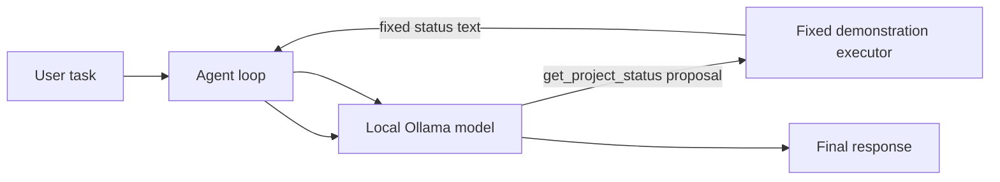
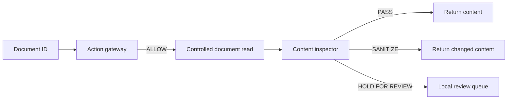
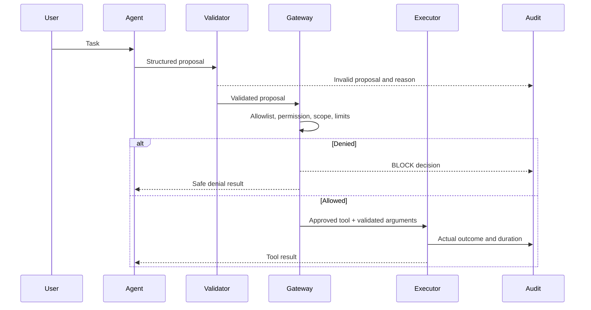

# Architecture

## Status

The current checkpoint implements a local model client, validated message shapes, a bounded demonstration agent loop, controlled local tools, an action gateway, hybrid content inspection, sanitization, a local review queue, concise SQLite security events, and a Streamlit dashboard. FastAPI, end-to-end model-to-gateway integration, and complete execution auditing remain pending.

## Current demonstration flow

`get_project_status` has no arguments and returns a fixed string. It does not read files, query a database, send a message, or invoke a command. The loop accepts at most three tool rounds. This is a controlled teaching step; the policy gateway will replace the simple dispatcher in milestone 4.

## Controlled local tools

Milestone 3 implements tools independently from the model loop:

- `search_documents` searches the two approved synthetic documents.
- `read_document` accepts a document ID and maps it to a fixed file name.
- `get_project_record` uses one parameterized SQLite query.
- `draft_message` creates a local `DRAFT` record for an approved synthetic recipient.

These tools are genuine local operations but are not yet connected to the model. The action gateway validates, authorizes, and dispatches requests to them; model integration will use that route in a later milestone.

## Action gateway

`ActionGateway` receives a structured task ID, tool name, and argument object. It blocks malformed requests, unknown tools, invalid arguments, out-of-scope resources, and calls that exceed configured limits. Only an allowed request reaches `ControlledToolExecutor`.

The gateway returns an authorization decision and a separate execution outcome. It keeps an in-memory decision history during this milestone. The model is not yet connected to the controlled tools; that integration will route every model proposal through this gateway.

## Secure document retrieval

`SecureDocumentRetrieval` implements one complete security path for a document ID:

The inspector combines validation, Unicode normalization, invisible-character removal, encoded-payload checks, transparent patterns, and an advisory structured assessment from the local model. A direct instruction to expose sensitive data is held for review. A clear instruction override or exact suspicious span may be replaced with `[Suspicious instruction removed.]`. Text that merely discusses security concepts can pass. Sanitized content remains untrusted.

## Components and responsibilities

1. **Interface** — the current Streamlit dashboard accepts text, presents inspection/retrieval results, shows review items, and displays stored security events.
2. **Agent loop** — sends the task and relevant context to a local Ollama model, parses a proposed structured tool call, and continues with a result or produces a final response. The model proposes; it does not execute.
3. **Schema validation** — Pydantic models validate the tool name and shape/types/limits of arguments. Valid shape alone does not grant permission.
4. **Content inspection** — labels source and sensitivity, applies transparent initial rules, and returns PASS, SANITIZE, or HOLD FOR REVIEW. It is a risk signal, not the action authorization mechanism.
5. **Policy and permission checks** — independently checks the allowlisted tool, caller permissions, resource scope, and operation limits. A prohibited action is blocked; human content review cannot override this.
6. **Controlled executor** — maps approved tool names to fixed Python functions. No shell, arbitrary Python, model-provided SQL, or arbitrary path access.
7. **Audit store** — stores concise local security events while minimizing sensitive content. Complete execution timing/outcome coverage is still pending.
8. **Local resources** — approved document corpus, SQLite records through fixed parameterized functions, and a simulated outbox.
9. **Human review** — stores unresolved content and a reviewer decision, including the exact excerpt approved for use.

## Tool-call flow

Every execution path must go through the gateway, including API and dashboard initiated actions. Unknown tools and malformed arguments fail closed. Tool-call count, repeated calls, input size, and execution time need explicit limits.

## Content-protection flow

Returned or retrieved text keeps separate metadata fields: `source_id`, `content_id`, `origin_trust` (trusted/untrusted), and `data_sensitivity` (public/internal/confidential). The MVP is not a full information-flow tracking system. Inspection decisions and transformations should record a reason and retain provenance. Clearly isolated suspicious spans may be sanitized; ambiguous cases are held. Sanitized material remains untrusted. A reviewer may reject it or approve a specific excerpt after inspection; approval does not grant tool permissions.

## Failure handling

- Parse/schema errors: do not execute; return a bounded error and record the decision.
- Unknown tool, denied permission, or out-of-scope resource: block and log.
- Tool exception or timeout: record the failed outcome; do not represent it as success.
- Inspector/review storage unavailable: fail closed for unresolved content rather than silently pass it.
- Ollama unavailable or malformed model output: stop the loop safely; enforce a maximum iteration count.
- Logs: store argument summaries and reason codes where possible, not full sensitive content or secrets.

## Boundaries and trade-offs

The gateway is an application-level control. It cannot contain arbitrary code running in the same compromised process, stop a hostile administrator, or replace OS permissions. Rule-based prompt-injection detection will miss attacks and may flag benign text. The MVP favors fixed tools and understandable controls over broad capabilities. Detection never substitutes for action authorization.

## Planned integration order

Milestones 1–5 are implemented and verified at their documented scope. The present checkpoint adds hybrid inspection and a local dashboard. Model-to-gateway integration, a FastAPI layer, evaluation, and final hardening remain in milestones 6–10. Details and statuses are in the tracker.

## Current dashboard and hybrid inspection

`app.py` is a local Streamlit dashboard that calls the real project services. It can inspect entered text, retrieve approved documents through the gateway, show held review items, and display stored security events.

Prompt inspection combines input validation, Unicode normalization, invisible-character removal, encoded-payload checks, transparent instruction-pattern checks, and a structured advisory assessment from the local Qwen model. The local model returns `benign`, `suspicious`, or `high_risk` with exact suspicious spans. High-risk and uncertain results are held for review. A suspicious result is sanitized only if the returned span occurs exactly in the inspected text.
